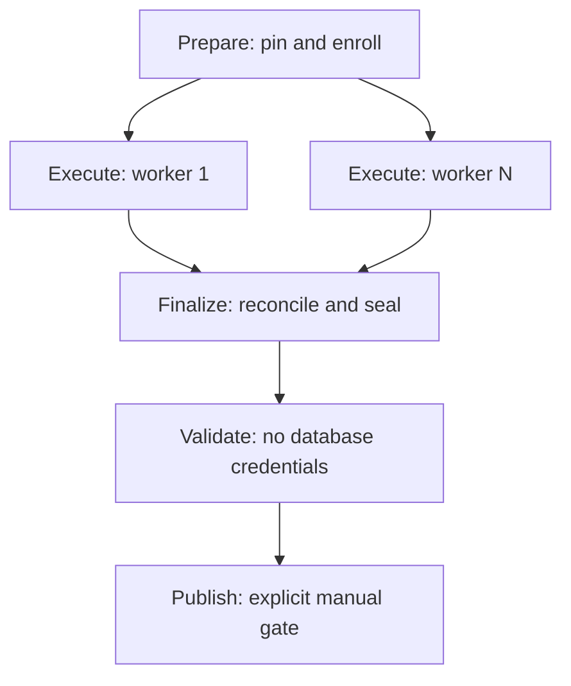

# Proposal: Test262 prepare / execute / finalize

Status: **proposed; awaiting review**. Related: [#2362](https://github.com/tomacox74/js2il/issues/2362), [Project 3](https://github.com/users/tomacox74/projects/3).

Source review: master `d1d8cd4368587b6dfca8e829b7cadaa9225b5ee3` (November 2, 2026). This document proposes contracts and implementation gates. It does not implement or establish acceptance of concurrent production execution.

## 1. Recommended architecture

Prepare one bounded collection centrally, execute its queue on independently authenticated Actions runners, and finalize it centrally after execution is quiescent. Use **one coordinator collection run plus a separate run for each worker execution, sharing one budget across all workers and Actions retries**.

Reuse the existing PostgreSQL queue, generation-fenced leases, reservation accounting, trusted provenance, SQLite outbox, independent-worker isolation, native seal, credential-free validation and publication reservation. Add explicit collection membership and lifecycle support where the existing APIs assume a single Actions owner. Do not create a second scheduler or duplicate the catalogue in artifacts.

Retain `worker_count=1` as the deployment default until rollout acceptance. Allow reviewed configurations of 1, 2, 4 and 8 workers, with an initial pilot progression of 1 then 2 then 4; 8 is a benchmark option, not an approved production default. Limits on candidates, accepted fixtures, attempts and aggregate execution time stay independent of worker count.

Arrows describe dependencies, not unconditional success. Finalization also assesses failed, skipped and missing workers. An interrupted workflow may need the existing independent lifecycle reconciler; an `always()` step is not durable recovery by itself.

## 2. Current implementation and the gaps this resolves

The following are source observations, not fresh production readbacks:

| Existing contract | Consequence for this proposal |
| --- | --- |
| [`test262-central.yml`](../../.github/workflows/test262-central.yml) combines prepare, work, seal/generate, recovery flush and lifecycle in `supervise`; `validate` and `publish` are separate | Split the supervisor while preserving the existing validation/publication boundaries. Today sealing occurs before the always-run recovery flush; the proposed barrier moves sealing after reconciliation. |
| [`commands.prepare_from_inventory`](../../scripts/test262/central/commands.py) creates the run, budget, bounded membership, registration target and reconciliation plan | Prepare once per collection attempt; workers do not rerun selection, update targets or advance the discovery cursor. |
| [`api_claim`](../../supabase/migrations/20261023193000_test262_catalogue_budget_lifecycle.sql) restricts `actions:<id>` budgets to the original trusted producer and exact `actions:<id>:<attempt>` owner-run namespace | Separate producer-owned worker runs cannot currently claim these budgets. Add an explicit managed-collection branch; do not rename the budget to bypass this guard. |
| [`enlist.py`](../../scripts/test262/central/enlist.py) already supports separate producer-owned runs and verifies exact checkout/provenance, but deliberately requires a non-Actions budget | Reuse its verification, freshness and replay behavior through a distinct managed-Actions entry point. Preserve existing local/downstream enlistment behavior. |
| [`api_finish_budget`](../../supabase/migrations/20261023193000_test262_catalogue_budget_lifecycle.sql) understands single-owner Actions attempts only | Extend it for an explicitly registered collection and its exact worker membership. Existing serial scopes keep their current behavior. |
| [`lifecycle.actions_plan`](../../scripts/test262/central/lifecycle.py) recognizes one `supervise` job and fixed step names | Add versioned split-workflow reconciliation; retain the legacy reader for historical runs. Unknown job layouts remain unresolved. |
| [`api_metric`](../../supabase/migrations/20261004000100_test262_catalogue_api_v1.sql) has one versioned metric per `(run_id, stage)` | Worker runs retain their own metrics. One finalizer writes a deterministic parent aggregate; workers must not overwrite one shared `screening` metric. |
| Current policy in [`schedule.py`](../../scripts/test262/central/schedule.py) is weekly **native**, manual default **MVP**, and no automatic publication | Preserve that actual policy. The earlier reference to scheduled MVP in #2363 needs alignment during implementation. |

Existing independent execution and recovery are documented in [the central catalogue guide](Test262SupabaseCatalog.md#independent-local-and-downstream-workers-2339). Those receipts are a foundation, not proof of simultaneous Actions runners or the new collection lifecycle.

## 3. Identity, allocation and context contract

### Identity decisions

| Entity | Proposed identity / ownership | Retry rule |
| --- | --- | --- |
| Allocation | Existing budget key `actions:<workflow_run_id>`, owned by the coordinator; one kind, immutable limits and claim cap | Charges, reservations and enrolled candidates survive retries; a retry cannot manufacture a new allowance. |
| Collection attempt | Existing owner-run key `actions:<workflow_run_id>:<prepare_attempt>` and deterministic run UUID | New preparation attempt gets a new owner run under the same budget. Exact replay of preparation must reuse its frozen plan. |
| Worker member | Coordinator-approved slot, producer UUID and dedicated database login | A different slot must not share its credential, outbox or child-run identity. Enrollment is an operator step. |
| Worker execution | Producer-owned child run, linked to one collection attempt, slot and actual Actions execution attempt | A rerun creates a new execution identity and links the predecessor. A terminal child run never starts executing again. |
| Queue work | Existing `(repository, provenance, fixture, variant, retry_generation)` identity | No per-worker clone of the queue. Claim lease generations fence retries; preserve existing work-attempt limits. |
| Observation / upload | Existing observation UUID and durable request UUID/payload digest | Replay retains both; a genuinely new execution gets a new observation UUID. |

Use the existing `identity(repository, producer, external_key)` helper for run UUIDs. A proposed child external key is `worker:<producer>:actions:<workflow_run_id>:<prepare_attempt>:<slot>:<execution_attempt>`, compatible with the current worker namespace and existing run-key bound. Store the actual immutable Actions job ID once observed; slot name alone is not authoritative job evidence. No IDs enter compiler/harness provenance merely because the work ran on another runner.

The allocation's first managed preparation freezes the candidate/work membership and limit policy. A later attempt of the same workflow may reconcile that membership and recover pending work, but cannot advance the cursor or enroll additional candidates. If source/provenance or the requested selection changes, fail that retry and use a separately authorized new collection. New ordinary scheduled invocations retain the current bounded backlog/discovery policy.

### Versioned context

The sanitized context is an immutable reference to a server-registered plan, never a bearer credential or permission grant. Preserve the existing context fields and add a versioned managed-collection envelope. The following is a field contract, not a ready-to-run context:

| Field group | Required content and checks |
| --- | --- |
| Contract | Context schema version, managed-collection capability version, writer epoch, repository ID/name, coordinator producer ID, collection run ID and budget ID |
| Actions origin | Repository numeric ID, workflow path, event, original workflow run ID, preparation attempt, event SHA and pinned target SHA; their roles must stay distinct |
| Evidence | Kind, corpus ID and exact upstream commit, provenance ID/full identity document, sealed registration snapshot and native validation identity where applicable |
| Plan | Area, exact enrolled work membership or canonical membership digest/count, candidate IDs, immutable budget limits/claim cap, approved slots/producers and worker-count bound |
| Build | Exact compiler/host binary manifest, harness/tooling digests, runtime/environment identity, fixture-image digest, options and timeouts |
| Lifecycle | Server-issued creation time, claim expiry, collection generation/version and preparation receipt/context digest |
| Artifact receipt (stored outside the hashed context) | Exact context/build artifact IDs and file digests once uploads are committed, with workflow run/attempt attribution; do not put an artifact's own ID into its content and create a digest cycle |

Canonical hashing uses the existing JSON identity helpers. Register the context digest centrally and compare it on worker admission; a self-consistent digest supplied only alongside a downloaded file does not authenticate its origin. Reject unsupported versions, unknown required fields, wrong repository/producer/epoch, stale target, changed bytes, closed membership or expired claim context.

Proposed claim window: at most 60 minutes from the server's preparation receipt, with each worker also retaining the current 600-second local execution bound and workflow timeout. This is a maximum claim window, not extra budget. Do not start work that cannot finish within the remaining approved execution window; record precise stop reasons. Extending an expired window requires a new registered attempt, with the same cumulative allowance. Replay of existing evidence remains distinct from new claims and is permitted under the original scope while the credential/epoch remains valid.

## 4. Stage contracts and permissions

### Prepare

1. Resolve policy once, validate authority/ref, select one exact clean master revision, and require the existing successful exact-SHA master-push MVP validation for native mode. Record the workflow event SHA separately: the current explicit master checkout can differ from it.
2. Before supplying database secrets, install locked dependencies, build the CLI/NativeScreeningHost and isolated fixture image, and acquire/verify the exact upstream pin. Produce one verified runtime bundle; workers use those bytes rather than assuming rebuilds are identical.
3. Under the existing target-preparation concurrency group shared with registration refresh, register/reuse the inventory, seal registrations, select/reconcile once, enroll the bounded shared budget, and freeze the collection/slot manifest. Persist the exact selected plan before mutable cursor advancement, or commit plan, queue insertion and cursor advancement atomically; a digest without recoverable membership is insufficient after a crash. Retain workflow-level serialization of same-kind central collections during the first rollout; parallelism initially occurs inside a collection.
4. Publish sanitized immutable context/build artifacts and their IDs/digests. No worker starts until the complete registered preparation receipt exists. A partial preparation can be replayed against its retained frozen plan, not recomputed from a moved cursor.

Preparation failure before context commitment admits zero workers. Partial database records remain auditable and are reconciled; do not delete them or reset counters as cleanup.

### Execute

Use `strategy.fail-fast: false` and a bounded matrix with `max-parallel` equal to the reviewed worker count. Keep failures visible; do not use `continue-on-error` to make a failed collection appear successful.

Each slot has its own protected worker credential/producer, work directory, child run, Docker containers and SQLite outbox. Use only the existing `test262_worker` execution-role capabilities; never put the coordinator connection or GitHub App secret on a worker. Build/download/verify operations run before secrets are supplied to the trusted worker process. Operator provisioning must verify the actual effective grants and that each protected environment exposes only its intended worker secret.

Admission reuses `check_checkout`/execution identity validation and server-checks collection membership. Workers verify the exact compiler/harness/tooling/capabilities/timeouts/environment and fixture image. Node's diagnostic minor version remains diagnostic under the existing provenance policy; do not silently broaden/narrow that policy in this change. A mismatch stops before claiming.

Claims use the same budget and enrolled pool. Recheck target freshness, active authority, claim window and collection generation before every claim. The new server-side membership/lifecycle checks must be atomic with reservation. The exact pinned checkout can cease to be master during execution; retain original provenance and block new claims on a superseded registered target, then revalidate freshness at sealing/publication. Do not claim this freezes GitHub master across a database transaction.

Keep the existing one-variant-at-a-time fixture boundary: network disabled, separate PID namespace, dropped capabilities, read-only staged runtime/upstream, one writable scratch mount, and no checkout, credential or outbox mounts. No new database permissions reach fixture containers.

Persist result and completion locally before acknowledgment. A disconnected worker finishes only its already leased variant, then stops on failed upload. A null claim currently means empty **or delayed**; add a bounded wait/recheck using server queue/lease/backoff state, not an assertion that all work finished. Stop on exhausted budget, expired context or local time/attempt bound, even if pending work remains.

On exit, flush, write the per-child screening/stop receipt, finalize only that child run, and retain a consistent SQLite backup plus its file manifest. Copying a live main `.sqlite` file alone is insufficient with WAL; snapshot after stopping the writer or use SQLite's backup API. Never merge SQLite files between workers.

### Finalize

Run an always-assessed, bounded coordinator job after prepare and all execute jobs, with explicit handling for failed/skipped dependencies. Preserve a separate workflow-completion reconciler for hard cancellation or lost runners.

1. Resolve expected slots, child runs and exact Actions job/attempt evidence from the registered collection. Require every expected slot to have a proven terminal disposition, including never-started jobs; missing history is unknown.
2. Close new-claim admission under the same repository lock used by claims. Do not seal while a member can obtain fresh work. Wait/reconcile already issued leases and uncertain ingestion within a bounded deadline; never release an unexpired lease or guess that an absent artifact means no work occurred.
3. Require replay of retained outboxes with their **original authenticated worker identity**, never the coordinator identity. This runs in that worker's cleanup or a recovery-only job using its own protected environment; the finalizer receives receipts, not a bundle of worker credentials. The coordinator cannot ingest a foreign producer's run under the current API. If replay credentials/artifacts are unavailable, retain incomplete recovery and stop publication. Add no cross-producer ingestion privilege. Recovery is upload-only and must execute no fixtures. Reassess the barrier after recovery jobs finish; do not attempt recovery after recording an immutable successful parent lifecycle.
4. Aggregate child metrics exactly once using an immutable manifest of included child IDs/metric versions. Parent wall time is elapsed collection time; aggregate worker time is a separately named sum. Report unique completed variants, execution attempts, retries, uncertain reservations and unexecuted work separately. Do not double-count parent and child summaries in dashboards.
5. Record parent collection lifecycle, then settle the managed shared budget through the reviewed extension. Active/unproven child runs, live reservations or accounting inconsistencies block budget closure; once expired, abandoned reservations are conservatively charged exactly once. Finalizer replay preserves original terminal timestamps/counters.
6. For native mode only, evaluate current-target acceptance after the barrier. Reuse required-variant, same-provenance, metadata/dependency, contradiction and invalidation checks. Retain contradictory trusted evidence across all runs of that provenance; do not erase it by restricting the positive evidence set. For positive evidence produced by this managed collection, require a proven accepted completion for its exact work/generation and the current registered pool. Late retained evidence alone cannot qualify as a managed successful completion. Any change needed in both `commands.seal` and SQL sealing guards is implementation work, not a guarantee already supplied by `api_complete`.
7. Generate a patch only from the fresh centrally sealed batch. Pass exact batch/context/patch digests to the existing credential-free `validate`, then permit the existing manual native `publish=true` gate. Scheduled runs never publish. Publication rechecks the current master base and central reservation; validation or publication failure must not rewrite collection history.

Initially, any infrastructure failure, missing slot, failed flush or unresolved lease prevents automatic patch publication, even when some fixtures have complete passing evidence. Preserve that evidence and report eligible subsets for later reviewed recovery. A bounded collection can be `complete` when all workers ended and uploads are proven even though the budget stopped early or JavaScript tests failed; it is not full-suite completion or a conformance claim.

## 5. Required API / reporting changes

These names describe proposed semantics; none of the new endpoints below exists at the reviewed SHA. Implement reviewed additive migrations and advertise a `managed_actions_collection_version` capability; old clients continue to use the existing serial path. Fail closed when the capability is missing.

| Change | Required behavior |
| --- | --- |
| Collection attempt / member records | Bind owner run, shared budget, source/provenance, epoch, frozen context/plan digest, expiry and approved slot/producer set. Bind each admitted child run to one member/execution attempt; immutable identity, versioned state and audit history. |
| Coordinator registration / quiescence API | Idempotently freeze a plan, register attempts/members and stop admission. Same repository lock and explicit generation/CAS as claims; no worker grants. |
| Managed worker admission | Authenticated producer matches its pre-approved slot; child run ownership/source/provenance and actual attempt match. One live execution per slot. Workers cannot select another collection, expand membership, extend expiry or mint allocations. |
| Managed branch in `api_claim` | For registered Actions collections, allow only the linked live owner/child attempts; preserve cap/TTL limits, work membership, reservation charging and generation fencing. Stale attempts cannot reopen a closed allocation. Keep the current single-owner branch for unmanaged serial budgets. |
| Managed branch in `api_finish_budget` | Coordinator owner only; inspect parent and all admitted children across attempts, including same-attempt replacements. Preserve dry-run planning, active/unknown refusals, conservative uncertain charging, limits and replay receipts. No worker budget-finalization privilege. |
| Lifecycle reconciliation | Authenticate collection and child job identities/source checkout evidence using a versioned job manifest, not just `supervise` or Actions event `head_sha`. Reconcile terminal child runs through a narrowly scoped coordinator recovery operation that validates membership/proof; it must not enable arbitrary foreign-run edits. Keep old-layout history support. |
| Native seal boundary | Enforce the managed admission barrier and accepted-completion requirements centrally as well as in Python. Keep existing fresh target, required variants and contradiction checks. |
| Reporting / coherent export | Expose collection-to-worker relationships and separate parent/child metrics through reviewed read-only views; add new records to backup/export/reconciliation contracts and restore checks. Preserve current view contracts and performance access. |

Database foreign keys and unique constraints should enforce repository/collection/producer ownership and one slot execution identity; do not rely only on a JSON manifest or CLI assertions. Keep existing lock serialization for the initial design and measure contention in #2366 before changing lock granularity. Operations remain short; fixtures and artifact transport run outside database transactions.

Rejected alternatives:

- **Same run and outbox for every matrix job:** loses worker attribution, conflicts on `(run_id, stage)` metrics and allows one worker to finalize the collection while peers execute.
- **One fresh budget per worker/retry:** multiplies approved allowance and undermines shared crash accounting.
- **Non-Actions budget key as a shortcut:** bypasses the existing Actions ownership/closure guarantees rather than extending them explicitly.
- **Coordinator credentials on all workers:** violates the existing execution-only boundary and gives workers target, allocation and sealing authority.

## 6. Failure and recovery matrix

| Event | Required response | Acceptance/publication consequence |
| --- | --- | --- |
| Prepare stops after cursor/queue insertion but before context upload | Reconcile the immutable plan/attempt and reuse it; no fresh selection or extra cursor advance | Workers blocked until context commitment is authenticated |
| Context/build absent, corrupt, wrong origin or identity mismatch | Fail before creating a claim; preserve diagnostic reason | No successful worker inferred |
| Worker cannot start / matrix dependency skips it | Record exact skipped/failed job or unresolved history | Parent incomplete/failed as appropriate; no automatic publication |
| Two workers race for the same variant | Existing locked claim grants one live generation; the other gets another eligible item or bounded wait | No duplicate live acceptance |
| Another variant is delayed or currently leased | Bounded recheck within local deadline; retain queued/leased counts | Null claim never establishes a drained collection |
| Ingest commits but response is lost | Replay the same request UUID and payload from the original outbox | One stored observation; no new execution implied |
| Ingest succeeds, completion response is lost | Replay durable completion for the same work/generation/observation | At most one settlement; no extra budget charge |
| Worker dies before retaining an outbox | Keep acknowledged central evidence; wait for lease expiry and conservatively charge abandoned reservation | Unretained result remains unknown; retry only within remaining limits |
| Lease expires and old worker returns | Retain its original evidence; do not complete/release/refund a newer generation | Late pass alone cannot promote managed acceptance; contradictory evidence still blocks |
| One worker fails while peers run | `fail-fast: false`; peers remain bounded, retain their receipts and evidence | Finalizer closes admission/reconciles; initial rollout blocks automatic publication |
| Master/target, epoch or credential changes | Stop new claims on stale/fenced scope; retain/quarantine original outboxes | No stale native seal/publication; never rewrite epoch to force replay |
| Finalizer crashes or workflow is cancelled | Existing independent reconciler uses versioned split-job proof; replay safe steps and settle only proven expired reservations | Unknown history stays unresolved; no fabricated completion |
| Finalizer/validate/publish-only rerun | Resolve original artifact IDs, context attempt and sealed patch; replay only that stage | Zero new screening claims or cursor/budget reset |
| Worker-only rerun | Admit a new execution under the frozen collection, same budget, after predecessor is terminal/quiescent; require supported attempt binding | Preserve prior charges; reject expired/stale/ambiguous contexts |
| Later contradictory evidence | Existing conflict propagation plus freshness checks | Block or invalidate acceptance; never silently retain a green batch |
| Recovery artifact expired or credential revoked | Report missing recovery material; use scoped central receipts where sufficient, otherwise operator review | Never infer flush success, recreate observations or re-enable credentials automatically |

## 7. Artifact, rerun and recovery rules

Use immutable names containing workflow run ID, **producing** attempt and slot/execution identity, for example `test262-context-<run>-<prepare_attempt>` and `test262-worker-<run>-<prepare_attempt>-<slot>-<execution_attempt>`. Do not keep the current run-only `overwrite: true` pattern for parallel evidence. Retain exact artifact IDs and manifest digests centrally; reject wildcard merging, missing members or digest mismatch. Enforce digest checks in the application even if an action reports a mismatch only as a warning.

A downstream rerun can consume an artifact produced by an earlier attempt. Resolve by registered producer attempt and exact ID, not by constructing every artifact name from the current `github.run_attempt`. Do not regenerate the runtime bundle or change selection just because finalization/validation is rerun. Initially, unsupported partial-rerun combinations fail with an explicit operator instruction; they must never silently reprepare. Dedicated disposable tests must establish the supported combinations before enabling the split workflow.

Keep the existing 90-day Actions convenience retention unless a separately adopted policy changes it. GitHub repository readers may download artifacts: allowlist sanitized context, receipts and consistent required recovery data; do not upload connection strings, environment dumps, credential files or unrestricted logs. Raw fixture payloads/outboxes require the existing retention/access review. If that review cannot approve Actions storage, a protected supported recovery destination is an enablement prerequisite; do not invent a public fallback. Preserve useful interrupted evidence and its missing-data status under #2414's policy.

## 8. Migration and implementation sequence

| Step / owner | Reviewable deliverable and gate |
| --- | --- |
| #2362 | Review this architecture, identity/budget choice, context expiry, failure matrix and API gaps. Leave issue open until review is recorded. |
| #2363, contract prerequisites | Add versioned collection/membership/claim/finalization support and compatibility tests in disposable PostgreSQL; preserve old clients. Add export/restore/reporting coverage. Do not activate production writes through a feature flag alone. |
| #2363, workflow split | Implement prepare/execute/finalize with **one** worker, immutable artifacts, original-attempt lookup and versioned lifecycle reconciliation. Verify serial semantic parity, native/MVP separation and schedule/manual policy. Retain the legacy supervisor path until parity/recovery acceptance. |
| #2364 | Add independently credentialed worker slots and bounded matrix; exact-bundle verification, per-worker outboxes and member receipts. Start with disposable two-runner overlap proof. |
| #2365 | Stress shared claims/accounting, crash/late results, identity fencing, artifact recovery, cancelled/missing finalizer and all supported rerun modes. Test security denial using actual SQL roles, not mocks alone. |
| #2366 | Compare 1/2/4/8 workers with identical pinned build/corpus/pool/limits. Separate wall time, aggregate runner minutes, database/transport overhead and retry cost; do not promise linear speedup. |
| #2367 | Adopt bounded production pilot and rollback/runbook/visibility. Resolve production prerequisites and verify operator go/no-go before raising worker count. |

Rollback within the new architecture sets concurrency back to one **after** admission is stopped and active workers/leases are reconciled. It does not delete runs, refund uncertain reservations, reset generation/cursor, or restore old authority. Retain additive schema and evidence. The legacy supervisor can accept only a fresh legacy collection after managed work is quiescent and compatibility is verified; never feed it a managed context it cannot reconcile. No production restore or epoch rollback is needed merely to reduce worker count.

The Assurance Registry backlog in Project 1 is independent. #2341's reporting acceptance should establish the production baseline before a parallel pilot; #2367 must reassess duplicate execution and visibility for the new workload. #2426's notification delivery remains separately deferred under the adopted dashboard-first policy. #2413/#2415 supply relevant recovery/fencing procedures and limitations; their entire broader backlogs are not prerequisites for design or isolated implementation. Required new tables and recovery paths must be covered by the pilot's actual restore/rollback contract.

## 9. Validation and review checklist

This proposal was checked against the repository sources listed above. It contains **no claimed new runtime, concurrency, deployment or recovery test results**. The following are implementation acceptance requirements:

- [ ] Two separate runners have overlapping fixture execution and disjoint live leases for the same registered pool; unique slot/producer/run/outbox attribution is queryable.
- [ ] One shared budget across 1/2/4/8 workers and supported retries enforces candidate, acceptance, attempt and aggregate time bounds; no stale attempt can reopen it, and no live lease is settled early.
- [ ] Exact claim generations and accepted completions govern results; lost ACKs, process death and late evidence cause no duplicate accepted observation or double charge. Contradictory trusted evidence cannot be hidden by worker selection.
- [ ] Workers cannot change inventory, targets, allocation/membership, discovery cursor, seal or publish. Fixtures cannot access database/network/host process secrets, including during error paths.
- [ ] A member cannot claim against another collection or slot; expired/revoked/wrong-epoch/provenance contexts fail before new work. Target changes during execution cannot authorize stale publication.
- [ ] Context/build/recovery artifacts have authenticated origin, producing-attempt identity, hard digest validation and consistent SQLite snapshots; missing artifacts/history remain unknown.
- [ ] Prepare partial failure is idempotent without duplicate selection/cursor advancement. Full, worker-only, failed-job, finalizer-only, validate-only and publish-only reruns either follow tested identities or fail closed.
- [ ] Hard cancellation and finalizer loss are reconciled by the independent workflow; metrics, terminal states and budget receipts remain idempotent and distinguish bounded completion from suite completion.
- [ ] Native and MVP evidence, optional compiler coverage, coherent export, registration refresh, performance reporting and existing publication gates retain their behavior; split one-worker mode has parity with the accepted serial path.
- [ ] Reporting distinguishes parent summaries from child attempts, worker-active time from collection wall time, and missing evidence from zero failures. New relationship data survives coherent backup/export/restore with restored writers fenced.
- [ ] Rollback to one worker is rehearsed after quiescence; no old worker can regain claim authority and no evidence/accounting is reset.

Recommended review outcome: accept or amend these contracts, then implement #2363. Approval of a proposal does not by itself provision credentials, deploy migrations, dispatch fixtures or activate parallel production execution.

## References

- [Central workflow](../../.github/workflows/test262-central.yml), [coordinator commands](../../scripts/test262/central/commands.py), [worker](../../scripts/test262/central/worker.py), [independent enlistment](../../scripts/test262/central/enlist.py), [execution identity](../../scripts/test262/central/execution_identity.py), [outbox/client](../../scripts/test262/central/client.py).
- [Run lifecycle migration](../../supabase/migrations/20261023170000_test262_catalogue_run_lifecycle.sql), [budget lifecycle migration](../../supabase/migrations/20261023193000_test262_catalogue_budget_lifecycle.sql), [worker execution role](../../supabase/migrations/20261024001000_test262_catalogue_worker_execution.sql).
- [Central catalogue contract](Test262SupabaseCatalog.md), [recovery runbook](Test262Recovery.md).
- GitHub documentation: [job dependencies](https://docs.github.com/en/actions/how-tos/write-workflows/choose-what-workflows-do/use-jobs), [matrix controls](https://docs.github.com/en/actions/how-tos/write-workflows/choose-what-workflows-do/run-job-variations), [rerunning jobs](https://docs.github.com/en/actions/how-tos/manage-workflow-runs/re-run-workflows-and-jobs), [workflow artifacts](https://docs.github.com/en/actions/tutorials/store-and-share-data), [artifact download access](https://docs.github.com/en/actions/how-tos/manage-workflow-runs/download-workflow-artifacts).
